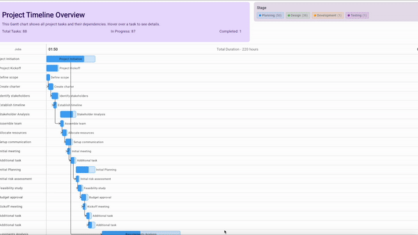

[](https://search.maven.org/search?q=g:%22io.github.kotlinlabs%22%20AND%20a:%22ganttly%22)
# Ganttastic

A modern Gantt chart implementation using Compose Multiplatform, targeting Wasm/JS with Kotlin.

## Features

- Interactive Gantt chart visualization
- Task dependencies with directional arrows
- Collapsible children tasks with smooth animations
- Customizable task colors and progress indicators
- Interactive tooltips with task information (scrollable)
- Timeline hover with vertical indicator showing date/time
- Customizable theme system (colors, styles, typography, naming)
- Task grouping with color coordination
- Smart task ordering and dependency handling
- Responsive layout with synchronized scrolling

## Demo



## Getting Started

### Installation

#### Gradle (Kotlin DSL)

```kotlin
// In your build.gradle.kts
dependencies {
    implementation("io.github.kotlinlabs:ganttly:$version")
}
```

## Basic Usage
```kotlin
fun main() { 
    CanvasBasedWindow("Ganttastic", canvasElementId = "ganttasticCanvas") {
        val ganttState = remember { createSampleNestedGanttState() }
        val customTheme = ganttTheme {
            naming {
                taskListHeader = "Jobs"
                taskGroups = "Stage"
                noGroupsMessage = "No stages found"
            }
        }

        GanttChartView(
            state = ganttState,
            headerContent = {
                // Optional header content that collapses on scroll
                Column(modifier = Modifier.fillMaxWidth().padding(16.dp)) {
                    Text(
                        "Project Timeline Overview",
                        style = MaterialTheme.typography.headlineMedium,
                        fontWeight = FontWeight.Bold
                    )

                    // Add your custom header content here
                }
            },
            ganttTheme = customTheme
        )
    }
}
```

## Customizing the Theme

Ganttly provides a comprehensive theme system that allows you to customize colors, styles, typography, and naming.

### Colors

```kotlin
val customTheme = ganttTheme {
    colors {
        // Define group color palette (used for automatic assignment)
        groupColorPalette = listOf(
            Color(0xFF2196F3), // Blue
            Color(0xFF4CAF50), // Green
            Color(0xFFFF9800)  // Orange
        )

        // Explicit group color mapping
        groupColorScheme {
            "Development" to Color.Blue
            "Testing" to Color.Green
            "Deployment" to Color.Orange
        }

        // Override default colors
        taskBarBackground = { baseColor, isHovered ->
            if (isHovered) baseColor.copy(alpha = 0.8f) else baseColor.copy(alpha = 0.6f)
        }

        taskBarBorder = { baseColor, isHovered ->
            baseColor.copy(alpha = if (isHovered) 0.9f else 0.7f)
        }

        taskBarProgress = { baseColor, isHovered ->
            baseColor.copy(alpha = if (isHovered) 0.9f else 0.8f)
        }

        dependencyArrowColor = { baseColor ->
            baseColor.copy(alpha = 0.7f)
        }

        taskBarBorder = { baseColor, isHovered ->
            baseColor.copy(alpha = if (isHovered) 0.9f else 0.7f)
        }

        taskBarProgress = { baseColor, isHovered ->
            baseColor.copy(alpha = if (isHovered) 0.9f else 0.8f)
        }

        dependencyArrowColor = { baseColor ->
            baseColor.copy(alpha = 0.7f)
        }
    }

    typography {
        taskBarTextStyle = TextStyle(
            fontFamily = FontFamily.Monospace,
            fontSize = 12.sp
        )
    }

    naming {
        taskListHeader = "Sprint Tasks"
        taskGroups = "Team"
    }
}
```

### Styles

```kotlin
val customTheme = ganttTheme {
    styles {
        // Task bar styling
        taskBarHeight = 0.7f
        taskBarCornerRadius = 0.25f
        taskBarTextPadding = 4.dp

        // Dependency arrow styling
        dependencyArrowWidth = 1.5.dp
        dependencyArrowHeadSize = 7.dp
        dependencyArrowCornerRadius = 4.dp

        // Row and border styling
        rowBorderWidth = 0.5.dp
        timelineHeaderBorderWidth = 0.5.dp

        // Group tag styling
        groupTagShape = 4.0f
        groupTagBorderWidth = 1.dp
        groupTagPadding = 8.dp

        // Show/hide task progress
        showTaskProgress = true
    }
}
```

### Typography

```kotlin
val customTheme = ganttTheme {
    typography {
        // Task bar text
        taskBarTextStyle = TextStyle(
            fontFamily = FontFamily.SansSerif,
            fontSize = 12.sp
        )

        // Timeline header text
        timelineHeaderTextStyle = TextStyle(
            fontFamily = FontFamily.Monospace,
            fontSize = 14.sp,
            fontWeight = FontWeight.Bold
        )

        // Tooltip text
        tooltipTitleStyle = TextStyle(
            fontFamily = FontFamily.Serif,
            fontSize = 16.sp,
            fontWeight = FontWeight.Bold
        )

        tooltipBodyStyle = TextStyle(
            fontSize = 14.sp
        )

        // Task list text
        taskListTextStyle = TextStyle(
            fontSize = 14.sp
        )

        // Group header text
        groupHeaderTextStyle = TextStyle(
            fontSize = 14.sp
        )
    }
}
```

### Naming

```kotlin
val customTheme = ganttTheme {
    naming {
        // Change text labels
        taskListHeader = "Activities"
        taskGroups = "Department"
        noGroupsMessage = "No departments assigned"
        subtasks = "Sub-activities"
    }
}
```

### Complete Theme Example

```kotlin
val customTheme = ganttTheme {
    colors {
        groupColorScheme {
            "Backend" to Color(0xFF2196F3)
            "Frontend" to Color(0xFF4CAF50)
            "DevOps" to Color(0xFFFF9800)
        }
    }

    styles {
        taskBarHeight = 0.8f
        showTaskProgress = true
    }

    typography {
        taskBarTextStyle = TextStyle(
            fontFamily = FontFamily.Monospace,
            fontSize = 12.sp
        )
    }

    naming {
        taskListHeader = "Sprint Tasks"
        taskGroups = "Team"
    }
}

GanttChartView(
    state = ganttState,
    ganttTheme = customTheme
)
```

## Creating Task Hierarchies

### Basic Tasks

```kotlin
import kotlinx.datetime.*
import kotlin.time.Duration.Companion.hours

val now = Clock.System.now().toLocalDateTime(TimeZone.UTC)

// Simple task
val task = GanttTask(
    id = "task1",
    name = "Design Phase",
    startDate = now,
    duration = 5.hours,
    progress = 0.5f,
    group = "Development",  // Optional grouping
    url = "https://example.com"  // Optional clickable URL in tooltip
)
```

### Parent Tasks with Children

```kotlin
val projectTask = GanttTask.createParentTask(
    id = "project",
    name = "Full Project",
    startDate = now,
    group = "Development",
    children = listOf(
        // This is a nested parent task
        GanttTask.createParentTask(
            id = "phase1",
            name = "Phase 1",
            startDate = now,
            group = "Development",
            children = listOf(
                // Child tasks of Phase 1
                GanttTask(
                    id = "task1.1",
                    name = "Task 1.1",
                    startDate = now,
                    duration = 2.hours,
                    progress = 0.5f
                ),
                GanttTask(
                    id = "task1.2",
                    name = "Task 1.2",
                    startDate = now.plus(2.hours),
                    duration = 3.hours,
                    progress = 0.3f,
                    dependencies = listOf("task1.1")  // Task dependencies
                )
            ),
            progress = 0.4f
        ),
        // Another nested parent task
        GanttTask.createParentTask(
            id = "phase2",
            name = "Phase 2",
            startDate = now.plus(5.hours),
            group = "Testing",
            children = listOf(
                // Child tasks of Phase 2
                GanttTask(
                    id = "task2.1",
                    name = "Task 2.1",
                    startDate = now.plus(5.hours),
                    duration = 4.hours,
                    progress = 0.0f,
                    dependencies = listOf("task1.2")  // Depends on task from Phase 1
                )
            ),
            progress = 0.0f
        )
    ),
    progress = 0.2f
)
```

### Task Dependencies

```kotlin
// Tasks can depend on other tasks
val task1 = GanttTask(
    id = "backend",
    name = "Backend Development",
    startDate = now,
    duration = 10.hours
)

val task2 = GanttTask(
    id = "frontend",
    name = "Frontend Development",
    startDate = now.plus(10.hours),
    duration = 8.hours,
    dependencies = listOf("backend")  // Depends on backend task
)

val task3 = GanttTask(
    id = "testing",
    name = "Integration Testing",
    startDate = now.plus(18.hours),
    duration = 5.hours,
    dependencies = listOf("backend", "frontend")  // Depends on both
)
```

### Creating Gantt State

```kotlin
val ganttState = remember {
    GanttChartState(
        tasks = listOf(task1, task2, task3, projectTask),
        enableSmartOrdering = true  // Automatically orders tasks by dependencies
    )
}
```


## Platform Support
- Web (Wasm/JS)
- Android (planned)
- Desktop (planned)
- iOS (planned)

## Architecture
Ganttastic is built with:
- Kotlin Multiplatform
- Compose Multiplatform
- Kotlinx.datetime for cross-platform date handling

## Contributing
Contributions are welcome! Please feel free to submit a Pull Request.
1. Fork the repository
2. Create your feature branch (`git checkout -b feature/amazing-feature`)
3. Commit your changes (`git commit -m 'Add some amazing feature'`)
4. Push to the branch (`git push origin feature/amazing-feature`)
5. Open a Pull Request

Please make sure to update tests as appropriate and adhere to the existing coding style.
## License
This project is licensed under the MIT License - see the [LICENSE](LICENSE) file for details.
## Acknowledgments
- Developed pairing with Jetbrains IntelliJ IDEA - Community Edition [AI Assistance](https://www.jetbrains.com/ai-assistant/)

## Advanced Features

### Header Content

You can add custom content that appears above the Gantt chart and collapses on scroll:

```kotlin
GanttChartView(
    state = ganttState,
    headerContent = {
        Column(modifier = Modifier.fillMaxWidth().padding(16.dp)) {
            Text(
                "Project Timeline Overview",
                style = MaterialTheme.typography.headlineMedium,
                fontWeight = FontWeight.Bold
            )

            // Add group info header
            GroupInfoHeader(
                groupInfo = ganttState.getGroupColorMapping(),
                taskCountProvider = { group ->
                    ganttState.displayTasks.count { it.group == group }
                }
            )
        }
    }
)
```

### Smart Ordering

Enable smart ordering to automatically arrange tasks based on dependencies:

```kotlin
val ganttState = GanttChartState(
    tasks = tasks,
    enableSmartOrdering = true
)
```

### Custom Row Height and Layout

```kotlin
GanttChartView(
    state = ganttState,
    taskListWidth = 250.dp,
    rowHeight = 40.dp,
    headerHeight = 50.dp,
    showTaskList = true  // Toggle task list visibility
)
```

## Roadmap
- [x] Publish library
- [x] Implement hierarchical tasks with smooth animations
- [x] Add collapsible project header
- [x] Timeline hover with vertical indicator
- [x] Customizable typography system
- [x] Scrollable tooltips
- [ ] Add cool animations
- [ ] Implement critical path calculation
- [ ] Dark mode support

## Contact
Project Link: [https://github.com/kotlinlabs/ganttastic](https://github.com/kotlinlabs/ganttastic)